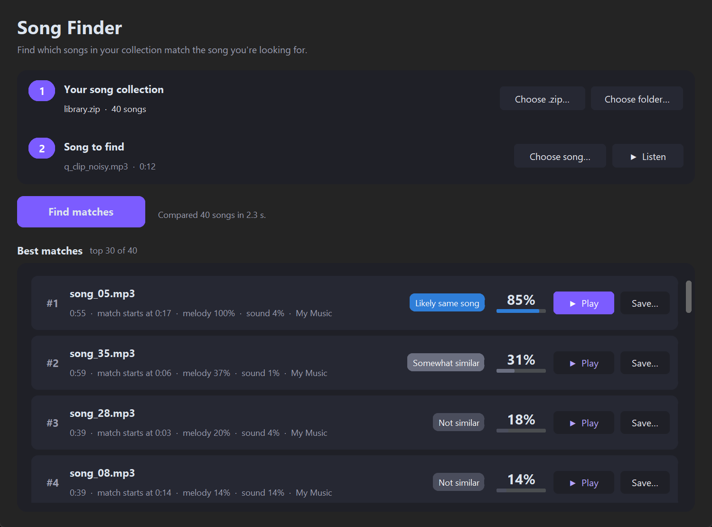

# Song Finder

Give it a collection of songs (a `.zip` of MP3s or a folder) and one song or clip,
and it ranks the collection by how well each song matches.

- **Exact match**: the same recording, even from a short, noisy or low-quality clip
  (audio fingerprinting).
- **Likely same song**: same melody and chords but a different version
  (live, cover, other key, sped up…).
- **Similar / Not similar**: everything else, ranked by melody and overall sound.

Results can be played in the app (starting where the match begins) and saved out of the zip.



## Download

Grab **SongFinder.exe** from the [latest release](https://github.com/agentyautja/song-finder/releases/latest)
and run it. No installation or Python needed (Windows 10/11, 64-bit).

Windows may show *"Windows protected your PC"* the first time because the app isn't code-signed.
Click **More info → Run anyway**.

## Run from source

```
pip install -r requirements.txt
python main.py
```

## Build the .exe

```
python build.py
```

This produces `dist/SongFinder.exe`, a single file that runs on any 64-bit Windows 10/11 PC
without needing Python.

## Code

| File | What it does |
| --- | --- |
| `engine.py` | Decoding, feature extraction (fingerprint, chroma, timbre) and scoring |
| `gui.py` | The window (customtkinter) |
| `player.py` | Audio playback from any position |
| `build.py` | PyInstaller build |
| `tools/` | Test data generator, engine check, UI smoke test, icon generator |

`python tools/make_test_data.py` followed by `python tools/check_engine.py` checks
that the matching still finds the right songs after you change something.
